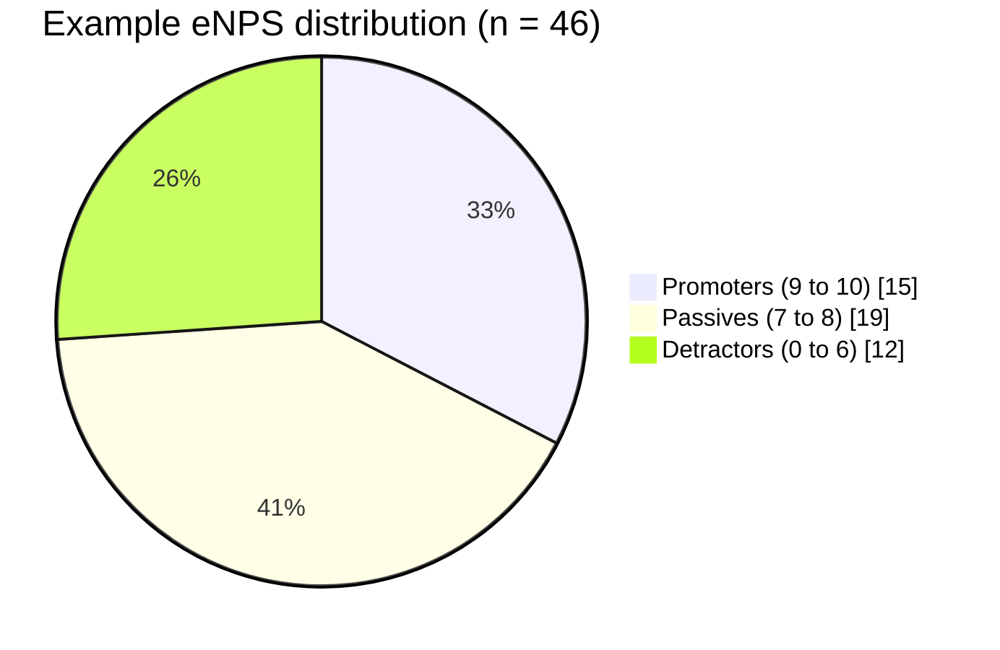
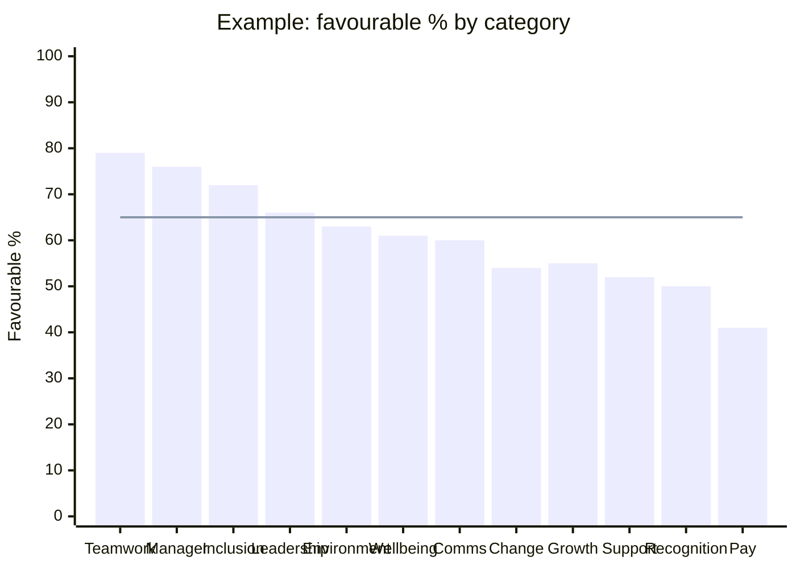
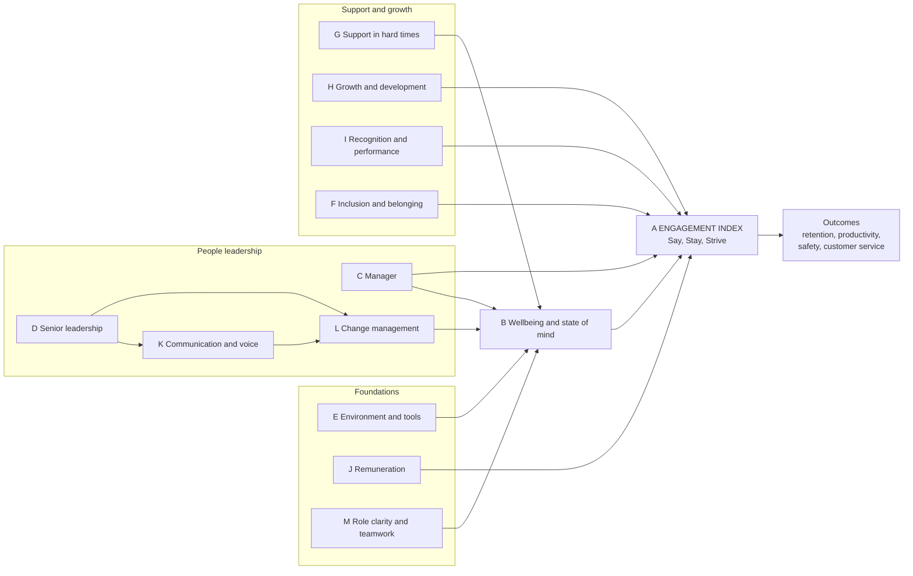
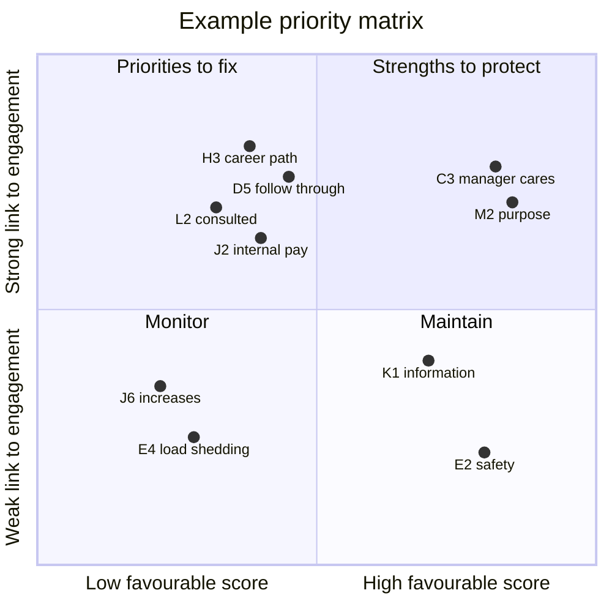

# Interpreting the Results

### Employee Engagement Survey, a product of X-Capital Resources: People

This guide explains how X-Capital Resources: People scores the survey, how leaders should read each number and chart, how the questions link to one another, and how results compare with global benchmarks. The charts use **example data** to show how a report reads. They are not real results.

---

## 1. The five numbers to read first

| Measure | How it is calculated | What it tells you |
|---|---|---|
| **Response rate** | Completed surveys ÷ employees invited | How far you can trust the results. Below 50%, treat results as a signal only. |
| **Engagement Index** | Average favourable % of A1 to A6 | How committed people are: whether they speak well of the organisation (Say), plan to stay (Stay) and give extra effort (Strive). |
| **eNPS** | % scoring 9 to 10 minus % scoring 0 to 6 on N1 | How many people are active advocates compared with active critics. |
| **Category scores** | Average favourable % of the items in each section B to M | Which parts of the employee experience are working and which are not. |
| **Priority drivers** | Statements that score low but are strongly linked to the Engagement Index | Where action will lift engagement the most. |

### Favourable, neutral, unfavourable

Every statement is scored on a 1 to 5 scale and reported as three percentages:

- **Favourable:** % who answered 4 (Agree) or 5 (Strongly agree)
- **Neutral:** % who answered 3
- **Unfavourable:** % who answered 1 (Strongly disagree) or 2 (Disagree)

"Not applicable / I don't know" answers are left out of the calculation. The favourable % is the headline figure used by most global providers (Kincentric, Glint, Qualtrics, Culture Amp, Perceptyx) because it is easy to explain and to track.

**Always look at the unfavourable % too.** Two statements can both be 60% favourable, but one with 35% unfavourable is far more urgent than one with 10% unfavourable and 30% neutral. A high neutral % usually means people are unsure, uninformed or cautious about answering, which is often a communication issue rather than a negative experience.

---

## 2. Reading the Engagement Index

| Engagement Index | Band | What it means | Typical response |
|---|---|---|---|
| 75% and above | **High** | Most people are committed and energised. | Protect strengths, keep listening. |
| 65% to 74% | **Healthy** | Solid base with clear areas to improve. | Focus on 2 or 3 priority drivers. |
| 50% to 64% | **Moderate** | A sizeable group is disengaged or uncertain. Turnover and productivity risk. | Leadership-led action plan within 60 days. |
| Below 50% | **Low** | Disengagement is the norm. | Urgent intervention, starting with leadership trust and the most basic needs. |

### How this compares globally

Engagement is measured in two different ways around the world, and the numbers are not interchangeable:

| Approach | Example providers | Typical figure | Compare with |
|---|---|---|---|
| **Favourable index** (average % agreeing with engagement items) | Kincentric, Glint, Perceptyx, Culture Amp, this survey | Kincentric reported global engagement of 73% at its 2020 peak, falling to 67% by the end of 2020. Perceptyx's 2025 global benchmark is 79.5%. | Your **Engagement Index** |
| **Classification** (% of people who are "fully engaged") | Gallup, ADP Research | Gallup: 21% of employees engaged globally (2025 report) and 19% in sub-Saharan Africa (2026 report). ADP: 27% of South African workers fully engaged in 2025. | The % of your people who answer 4 or 5 on **all six** A items |

So an Engagement Index of 68% and a Gallup-style figure of 22% can describe the same workforce. To produce a Gallup-style comparison, X-Capital Resources: People also reports the share of respondents who are favourable on every Engagement Index item.

### A South African caution on "Stay" items

South Africa's unemployment rate has been above 30% for several years. In this labour market, people may score A3 and A4 (intent to stay) highly because they have few alternatives, not because they are engaged. Always read Stay alongside Say and Strive:

| Pattern | Likely meaning | Risk |
|---|---|---|
| High Say, high Stay, high Strive | Genuinely engaged | Low |
| Low Say, high Stay, low Strive | **"Stuck" or trapped**: staying for job security only | Low productivity, presenteeism, quiet quitting |
| High Say, low Stay | Proud of the organisation but planning to leave, often due to pay (J1, J2) or career path (H3) | Loss of good people |
| High Strive, low B scores | Giving extra effort at a personal cost | Burnout |

---

## 3. Reading eNPS

In this example, 33% are promoters and 26% are detractors, so **eNPS = 33 − 26 = +7**.

| eNPS | Common reading |
|---|---|
| Below 0 | Needs improvement: more critics than advocates |
| 0 to +10 | Positive, but fragile |
| +10 to +30 | Good / around average |
| +30 to +50 | Very good |
| Above +50 | Excellent |

**Benchmarks.** CultureMonkey's Q2 2026 data puts the median eNPS at **+27**, with the middle half of organisations between **+12 and +44** and the top 10% from about **+56**. Smaller companies (up to 250 employees) tend to score higher, averaging around **+30**, than very large ones (around **+9**). eNPS varies widely by industry, so compare with similar organisations where possible and, above all, with your own previous result.

**Why eNPS and the Engagement Index can disagree:** eNPS is one question and is sensitive to small numbers of people. In groups under 30, a change of 2 or 3 people can move eNPS by 10 points or more. Treat the Engagement Index as the main measure and eNPS as a supporting one.

---

## 4. Reading the category chart

*The line marks the 65% "healthy" threshold.*

How to read it:

1. **Start at the bottom.** Categories under 50% need attention regardless of anything else. In the example, Pay (Section J) is the clear concern.
2. **Look for clusters.** Change, Growth, Support and Recognition all sit in the 50s. Together they suggest employees feel the organisation asks a lot but gives limited support and reward in return. This is a social exchange imbalance (see document 02).
3. **Do not chase the lowest score automatically.** Use the driver analysis (section 6) to see whether the lowest scores actually affect engagement. Pay is often low everywhere; it matters most when it also drives Stay scores.
4. **Check the spread within the category.** Open the item detail. One very low item can pull a category down, and the fix may be narrow (for example only E4, load shedding plans).

---

## 5. How the questions link to each other

The survey is built on a model where everyday experiences (drivers) shape how people feel (engagement), which in turn shapes what they do (outcomes).

### Diagnostic links: when one score is low, check these

| If this is low | Also check | What the combination tells you |
|---|---|---|
| **A3, A4** (intent to stay) | J1, J2, H3, C3 | Whether people plan to leave because of pay, lack of career path, or their manager. "People leave managers" is often true: if C3 is also low, start there. |
| **A5** (extra effort) | I1, I2, J3, B3 | Low effort with low recognition means effort is not noticed. Low effort with high workload (B3 low) means people have nothing left to give. |
| **B5** (burnout) | B2, B3, E3, L7 | If B2, B3 and B5 are all below 50%, X-Capital flags a **burnout risk**. E3 and L7 show whether broken processes or too much change are the cause. |
| **C5** (safe to disagree) | K6, K7, F5 | Together these measure **psychological safety**. Low scores here weaken every other result, because people are less honest in surveys and in meetings. |
| **D5** (leaders follow through) | L5, K8, G4 | All four measure **leadership credibility**. If they are low together, announcing new initiatives will not help until leaders deliver on past promises. |
| **D2** (clear direction) | D3, L1, K4 | Whether strategy is being communicated in a way that reaches the front line. |
| **J1** (market pay) vs **J2** (internal equity) | J3, J4, J5 | J1 low and J2 high: pay is consistent but below market. J2 low: perceived unfairness inside, which is more damaging. J3 and J4 low: people may be unhappy partly because they do not understand how pay works. |
| **J5** (consistent pay) | F2, F3, I4 | Possible equity concern. Check by demographic group (where groups are large enough) as part of Employment Equity monitoring. |
| **L2** (consulted on change) | L8, K6, G6 | Low consultation predicts low commitment to change (L8) and resistance. Also relevant to consultation obligations under the Labour Relations Act. |
| **L3** (support to adapt) | H2, E1 | Whether change fails because people were not trained or equipped. |
| **G1** (crisis support) | G2, G5, C3 | Whether support exists but people do not know about it (G2 low) or support is not offered (G5 low). |
| **H3** (career path) | H4, H6, C6 | Whether the problem is lack of opportunities or lack of conversations about them. |
| **K8** (survey confidence) | D5, L5 | Low K8 means people are cynical about surveys. **Visible action and "you said, we did" feedback are essential before the next survey.** |
| **F3** (transformation) | F2, J5, H6 | Whether transformation is seen as real (fair pay, fair promotion) or only as compliance. |

### Engagement profile examples

| Profile | Pattern | Interpretation |
|---|---|---|
| **The "family business" profile** | High C, F, M; low J, H, K | Strong relationships, but informal systems for pay, development and communication. Common in owner-led SMEs that have grown past 30 to 50 people. |
| **The "growth strain" profile** | High A, D; low B, L, E | People believe in the business, but rapid change and stretched resources are wearing them down. |
| **The "trust gap" profile** | Low D, K8, L5, G4 | Leadership credibility is the core issue. Fix communication and follow-through before anything else. |
| **The "transactional" profile** | High J, E; low A, F, H | Fair pay and conditions, but little belonging or growth. People do the job but no more. |

---

## 6. Driver analysis and the priority matrix

Not all low scores matter equally. **Driver analysis** measures how strongly each statement moves together with the Engagement Index across all respondents (a correlation from −1 to +1). Statements with a strong link and a low score are the priorities.

| Quadrant | Meaning | Action |
|---|---|---|
| **Priorities to fix** (top left) | Low score, strongly linked to engagement | Focus action plans here. Choose 2 or 3. |
| **Strengths to protect** (top right) | High score, strongly linked | Celebrate and keep doing it. Losing these hurts most. |
| **Monitor** (bottom left) | Low score, weak link to engagement | Still worth fixing if it is a legal, safety or basic hygiene matter (for example E4 or J6), but it will not lift engagement much on its own. |
| **Maintain** (bottom right) | High score, weak link | Keep standards steady. |

**Rules X-Capital applies:** driver analysis is only run with **10 or more** responses and is most reliable with **30 or more**. Correlation shows association, not proof of cause, so drivers are confirmed in team discussions before money is spent.

---

## 7. Comparing groups

Results are compared across departments, sites, job levels, length of service and other groups, but only where a group has **at least 5 respondents** (see document 03).

**Example heat map (favourable %)**

| Group | People | Engagement | Wellbeing | Manager | Leadership | Pay | Change | Comms |
|---|---|---|---|---|---|---|---|---|
| Operations | 18 | 🟨 61 | 🟥 48 | 🟩 74 | 🟨 58 | 🟥 35 | 🟥 46 | 🟨 55 |
| Sales and Customer Service | 12 | 🟩 73 | 🟨 62 | 🟩 79 | 🟩 70 | 🟨 50 | 🟨 60 | 🟩 66 |
| Finance and Administration | 9 | 🟩 70 | 🟨 64 | 🟩 72 | 🟩 71 | 🟨 52 | 🟨 61 | 🟩 68 |
| Smaller groups combined | 7 | 🟨 64 | 🟨 59 | 🟨 63 | 🟨 62 | 🟥 40 | 🟨 55 | 🟨 60 |

🟩 65% and above · 🟨 50% to 64% · 🟥 below 50%

### Is a difference real? Margins of error

With small groups, differences can be due to chance. Approximate margins of error at 95% confidence for a favourable % around 50%:

| Respondents | Margin of error | Difference needed to be meaningful |
|---|---|---|
| 5 | ±44 points | Treat as directional only |
| 10 | ±31 points | 20+ points, and confirm in discussion |
| 20 | ±22 points | 15+ points |
| 30 | ±18 points | 10+ points |
| 50 | ±14 points | 10 points |
| 100 | ±10 points | 5 to 7 points |

When most employees respond in a small organisation, the true margin is smaller because you have surveyed nearly everyone. Even so, **look for patterns that repeat across several items** rather than reacting to one number in one small group.

---

## 8. Comparing with last time

| Change since last survey | Reading |
|---|---|
| ±0 to 2 points | No real change |
| ±3 to 5 points | Possible change; check for consistency across related items |
| ±6 points or more | Meaningful change (in groups of 30+) |

Keep the wording of items the same each year so trends are valid. The 2026 version added Sections J (expanded), K items K3 to K5 and L (Change Management); these will have trend data from the second survey round onwards.

---

## 9. Reading the comments

1. Read all comments before the scores, if possible, to understand the tone.
2. Group them into themes and count them (for example "pay transparency: 14 comments").
3. Use comments to explain scores, not replace them. A few strongly worded comments may not represent the majority.
4. Look for practical suggestions; employees often propose the solution.
5. Never try to work out who wrote a comment (see document 03).

---

## 10. Response rate and confidence

| Response rate | Confidence in results |
|---|---|
| 85% and above | Very high. Typical for well-run surveys in organisations under 100 people. |
| 70% to 84% | High. Global good practice target. |
| 50% to 69% | Moderate. Results are useful but some voices may be missing. |
| Below 50% | Low. A low response rate is itself a finding: it often reflects low trust (check K8, C5) or access problems for frontline staff. |

---

## 11. Leader's checklist for the results meeting

- [ ] Response rate and whether any groups are under-represented
- [ ] Engagement Index and band, and the Say, Stay, Strive pattern
- [ ] eNPS, read alongside the Engagement Index
- [ ] Any burnout flag (B2, B3, B5) or safety concern (E2, F5, K7)
- [ ] Top 5 strengths and bottom 5 statements
- [ ] The 2 or 3 priority drivers from the matrix
- [ ] Group differences that are large and consistent
- [ ] Main comment themes
- [ ] Agreed next steps, owners and dates (see document 04)

---

## Sources for benchmarks

- Gallup, *State of the Global Workplace: 2025 Report*, global data: [gallup.com](https://www.gallup.com/workplace/697904/state-of-the-global-workplace-global-data.aspx) and [report PDF](https://gallup.com/file/workplace/659528/state-of-the-global-workplace-2025-download.pdf)
- Gallup, *State of the Global Workplace*, regional and country data (sub-Saharan Africa 19%): [gallup.com regional data](https://www.gallup.com/workplace/697850/state-of-the-global-workplace-regional-data.aspx) and [Ethiopia country page](https://www.gallup.com/workplace/705290/state-global-workplace-ethiopia-country-level-data.aspx)
- Gallup, *Global employee engagement continues to decline*: [gallup.com](https://www.gallup.com/workplace/708071/global-employee-engagement-continues-decline.aspx)
- ADP Research, *How engaged is the global workforce* (South Africa 27% fully engaged in 2025): [adpresearch.com](https://adpresearch.com/research/how-engaged-is-the-global-workforce)
- Kincentric global engagement trends (73% peak in 2020, 67% by Q4 2020): [AAP release](https://www.aap.com.au/aapreleases/cision20220719ae18772)
- Perceptyx, *2025 employee engagement trends by geography* (79.5% global benchmark): [perceptyx.com](https://blog.perceptyx.com/2025-employee-engagement-trends-by-geo-whats-the-local-story)
- CultureMonkey eNPS benchmarks (median +27): [culturemonkey.io](https://www.culturemonkey.io/benchmarks/enps-benchmarks/)
- SurveyMonkey eNPS benchmarks and ranges: [surveymonkey.com](https://www.surveymonkey.com/learn/employee-feedback/employee-nps-benchmarks/)
- *Employee Engagement in the African Context* (Emerald, 2025): [emerald.com](https://www.emerald.com/books/edited-volume/chapter-pdf/11276909/978-1-83797-466-520251015en.pdf)

Benchmark figures change every year and providers measure engagement differently. X-Capital Resources: People reviews these figures before each reporting season.

---

*© X-Capital Resources: People. Employee Engagement Survey companion document 01.*
