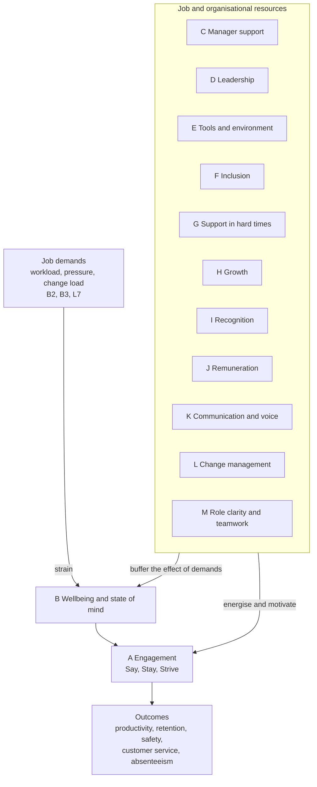

# The Science Behind the Survey

### Employee Engagement Survey, a product of X-Capital Resources: People

This document explains what the survey measures, the research it is built on, why each section is included, and how X-Capital Resources: People makes sure the results are reliable and valid in South African workplaces.

---

## 1. What is employee engagement?

Engagement is more than job satisfaction. A satisfied employee is content; an engaged employee is **invested**. The survey draws on three widely accepted definitions:

| Researcher | Definition | How the survey uses it |
|---|---|---|
| **William Kahn (1990)** | People bring their physical, cognitive and emotional selves to their work roles when they experience *meaningfulness*, *safety* and *availability*. | Meaningfulness (M2, A6), safety (C5, B6, K7) and availability (B1 to B5). |
| **Wilmar Schaufeli and Arnold Bakker (2002, 2004)** | Engagement is "a positive, fulfilling, work-related state of mind characterised by **vigour**, **dedication** and **absorption**", measured by the Utrecht Work Engagement Scale (UWES). | Vigour (B1), dedication (A1, A6) and the overall "state of mind" focus of Section B. |
| **William Macey and Benjamin Schneider (2008)** | Engagement has three layers: **trait** (personality), **state** (feelings of energy and involvement) and **behaviour** (extra effort, advocacy). | Section A captures state and behavioural engagement through Say (A1, A2), Stay (A3, A4) and Strive (A5, A6). |

The Say, Stay, Strive structure is the same one used in the Kincentric (formerly Aon Hewitt) engagement model, one of the most widely used commercial measures.

---

## 2. The model behind the survey

The survey combines five established theories.

### 2.1 Job Demands-Resources (JD-R) model

*Demerouti, Bakker, Nachreiner and Schaufeli (2001); Bakker and Demerouti (2007, 2017)*

Every job has **demands** (workload, pressure, emotional strain, constant change) and **resources** (support, feedback, autonomy, development, fair reward). High demands without enough resources lead to exhaustion and burnout. Resources drive engagement and also buffer the effects of high demands. This is the main reason the survey measures wellbeing (Section B) alongside the resources in Sections C to M, and why X-Capital flags a burnout risk when B2, B3 and B5 are all low.

The JD-R model has been tested extensively in South Africa, including in the mining, police, education and financial sectors (for example Rothmann and colleagues at North-West University).

### 2.2 Social Exchange Theory

*Blau (1964); applied to engagement by Saks (2006)*

Employment is a two-way relationship. When employees feel the organisation invests in them (through support, fair pay, development and recognition), they feel obliged to give back through effort and loyalty. Alan Saks (2006) showed that **perceived organisational support** and **job characteristics** were among the strongest predictors of engagement, and that engagement in turn predicted job satisfaction, commitment and lower intention to leave.

This is why the survey asks about support in hard times (G), growth (H), recognition (I) and remuneration (J): together they show whether employees feel the exchange is fair.

### 2.3 Perceived Organisational Support (POS)

*Eisenberger, Huntington, Hutchison and Sowa (1986)*

Employees form a general belief about how much the organisation values their contribution and cares about their wellbeing. High POS is linked to lower absenteeism, higher performance and stronger commitment. Section G measures POS in situations that are common in South Africa: family crises, financial stress, illness, bereavement and restructuring.

### 2.4 Organisational justice

*Adams (1965) equity theory; Greenberg (1987); Colquitt (2001)*

People judge fairness in three ways:

| Type of justice | Question people ask | Where measured |
|---|---|---|
| **Distributive** | Are outcomes (pay, promotions, recognition) fair? | J1, J2, J6, I4 |
| **Procedural** | Are the processes used to decide those outcomes fair and consistent? | J4, J5, H6, I3, G6 |
| **Interactional** | Am I treated with respect and given honest explanations? | C4, D4, F5, L1, K5 |

Research consistently finds that **procedural fairness can soften the impact of disappointing outcomes**: people accept a modest increase more readily when they understand and trust how it was decided. That is why Section J asks not only whether pay is fair, but also whether the remuneration policy is clear and consistently applied.

### 2.5 Psychological safety

*Edmondson (1999)*

Psychological safety is the shared belief that it is safe to speak up, ask questions and admit mistakes without being punished or humiliated. Google's Project Aristotle (2015) found it was the most important factor in effective teams. It is measured by C5, B6, K6 and K7. It also affects the survey itself: where psychological safety is low, people answer less honestly.

### 2.6 Self-Determination Theory

*Deci and Ryan (1985, 2000)*

People are most motivated when three needs are met: **autonomy** (M5), **competence** (H2, H7, L3) and **relatedness** (F1, F6, C3). These needs explain why development and belonging affect engagement even where pay is modest.

---

## 3. Why each section is included

| Section | Main research basis | Why it matters |
|---|---|---|
| A Engagement Outcomes | Kahn; Schaufeli and Bakker; Kincentric Say, Stay, Strive | The outcome the whole survey explains |
| B State of Mind and Wellbeing | JD-R model; UWES vigour; Maslach burnout research | Engagement is not sustainable if people are exhausted |
| C Immediate Manager | Gallup Q12 research; leader-member exchange (Graen and Uhl-Bien, 1995) | Gallup estimates managers account for at least 70% of the variance in team engagement |
| D Senior Leadership | Trust research (Mayer, Davis and Schoorman, 1995); Great Place to Work Trust Index | Trust in leadership underpins acceptance of decisions and change |
| E Environment, Tools and Safety | Herzberg's hygiene factors; Willis Towers Watson "enablement" | People cannot perform without the basics; SA infrastructure adds load shedding and commuter safety |
| F Inclusion and Belonging | Social identity theory; inclusion research (Shore et al., 2011); ubuntu | Belonging predicts commitment; fairness across groups is a legal and moral requirement in SA |
| G Support in Challenging Times | Perceived Organisational Support (Eisenberger et al., 1986) | Shows whether the organisation's care is real when it is tested |
| H Growth and Development | Self-Determination Theory; human capital theory | Lack of growth is one of the most common reasons people leave |
| I Recognition and Performance | Reinforcement theory; Gallup Q12 recognition item | Recognition is low-cost and strongly linked to discretionary effort |
| J Remuneration Standards and Policies | Equity theory (Adams, 1965); organisational justice; WorldatWork Total Rewards | Pay fairness affects retention; procedural clarity affects trust |
| K Communication and Voice | Employee voice research (Morrison, 2011); internal communication research | Information and voice are basic resources; rumours fill the gap where communication is weak |
| L Change Management | Lewin (1947); Kotter (1996); Prosci ADKAR (Hiatt, 2006); readiness for change (Armenakis, Harris and Mossholder, 1993) | Most change efforts struggle because of people factors; SMEs change often as they grow |
| M Role Clarity, Purpose and Teamwork | Job Characteristics Model (Hackman and Oldham, 1976); role theory | Clear, meaningful roles and good teamwork reduce strain and increase motivation |
| N eNPS | Net Promoter approach (Reichheld, 2003) adapted for employees | A simple, globally comparable advocacy measure |
| O Open questions | Qualitative research practice | Explains the "why" behind the numbers and surfaces solutions |

### How Section L (Change Management) maps to change models

| Change model stage | ADKAR element | Kotter step | Survey item |
|---|---|---|---|
| Understand why | Awareness | Create urgency, communicate the vision | L1 |
| Want to take part | Desire | Build a coalition, empower action | L2, L8 |
| Know how | Knowledge | Communicate the vision | L6 |
| Be able to | Ability | Remove obstacles | L3 |
| Make it stick | Reinforcement | Anchor in culture, consolidate gains | L5 |
| Execution quality | | Generate short-term wins | L4, L7 |

### How Section J (Remuneration) maps to the Total Rewards model

| Total Rewards element (WorldatWork) | Survey item |
|---|---|
| Compensation (market and internal) | J1, J2, J6 |
| Benefits | J7, J9 |
| Pay governance and transparency | J3, J4, J5 |
| Payroll accuracy and compliance (BCEA) | J8 |
| Recognition and performance | I1 to I4 |
| Development and career | H1 to H7 |
| Wellbeing | B1 to B6, G1 to G6 |

---

## 4. The evidence that engagement matters

| Finding | Source |
|---|---|
| Business units in the top quarter for engagement show substantially better results than those in the bottom quarter, including higher productivity and profitability, lower absenteeism and turnover, and fewer safety incidents. | Gallup Q12 meta-analysis (Harter et al., 2020, 10th edition), covering more than 100,000 business units |
| Low engagement costs the global economy an estimated US$8.9 trillion a year, about 9% of global GDP. | Gallup, *State of the Global Workplace* (2024) |
| Only 21% of employees worldwide are engaged, and 19% in sub-Saharan Africa. | Gallup, *State of the Global Workplace* (2025 and 2026 reports) |
| Perceived organisational support and job characteristics predict engagement, and engagement predicts commitment and lower intent to quit. | Saks (2006), *Journal of Managerial Psychology* |
| Job resources predict engagement in South African samples, and engagement is linked to lower turnover intention. | Rothmann and Rothmann (2010), *SA Journal of Industrial Psychology*; Storm and Rothmann (2003) |

---

## 5. How the questions are written

X-Capital Resources: People follows established item-writing principles:

1. **One idea per statement** wherever possible. A few items deliberately combine closely related ideas (for example F3, "transformation and employment equity") because employees experience them as one thing.
2. **Positive, first-person wording** ("I", "my manager") so people answer from their own experience rather than guessing about others.
3. **Concrete time frames** (for example "in the past month", "in the past 12 months") on behaviour items, to reduce vague answers.
4. **Plain language** at about a Grade 8 reading level, suitable for translation.
5. **A 5-point agreement scale with a neutral midpoint**, the format used by most global engagement surveys, which gives reliable results and is easy to translate.
6. **A "Not applicable / I don't know" option**, so people without experience of an issue (for example restructuring) are not forced to guess.
7. **The same scale direction throughout** (5 is always positive), which reduces errors on mobile phones and for respondents with lower literacy.

---

## 6. Reliability and validity

A survey is **reliable** if it measures consistently and **valid** if it measures what it claims to. X-Capital Resources: People checks both.

| Check | Method | Standard |
|---|---|---|
| **Internal consistency** | Cronbach's alpha (or McDonald's omega) for each section | 0.70 or higher is acceptable; 0.80 or higher is good |
| **Structure** | Confirmatory factor analysis to confirm items group into their intended sections | Comparative fit index (CFI) of 0.90 or higher; RMSEA of 0.08 or lower |
| **Predictive validity** | Correlation of section scores with the Engagement Index, and of the Engagement Index with later turnover and absenteeism | Positive and significant relationships |
| **Fairness across groups** | Measurement invariance testing across language, job level and population group | Items should mean the same thing to different groups before scores are compared |
| **Translation** | Forward and back-translation by first-language speakers, following International Test Commission guidelines | Translations reviewed for meaning, not word-for-word accuracy |
| **Pilot** | Cognitive interviews and a pilot with 20 to 30 employees from different levels | Items understood as intended |

As X-Capital builds a database across client organisations, these statistics are recalculated each year and published in a technical note, and a **South African SME benchmark** is built from pooled, anonymised results.

---

## 7. Reducing bias

| Possible bias | How the survey reduces it |
|---|---|
| **Fear of being identified** | Independent administration by X-Capital, minimum group sizes, and no individual reports (see document 03) |
| **Social desirability** (answering how you "should") | Anonymity, neutral wording, and reassurance that there are no right answers |
| **Acquiescence** (agreeing with everything) | Behaviour-specific items with time frames; checking for "straight-line" responses during analysis |
| **Access bias** (frontline staff missing out) | Mobile, WhatsApp, QR code, shared device and paper options, completed in paid time |
| **Language bias** | Translation into the workforce's main languages |
| **Labour market effects** | Stay items are read alongside Say and Strive because high unemployment can inflate intent to stay (see document 01) |

---

## 8. References

- Adams, J. S. (1965). Inequity in social exchange. *Advances in Experimental Social Psychology*, 2, 267-299.
- Armenakis, A. A., Harris, S. G., & Mossholder, K. W. (1993). Creating readiness for organizational change. *Human Relations*, 46(6), 681-703.
- Bakker, A. B., & Demerouti, E. (2007). The Job Demands-Resources model: State of the art. *Journal of Managerial Psychology*, 22(3), 309-328.
- Blau, P. M. (1964). *Exchange and Power in Social Life*. Wiley.
- Colquitt, J. A. (2001). On the dimensionality of organizational justice. *Journal of Applied Psychology*, 86(3), 386-400.
- Deci, E. L., & Ryan, R. M. (2000). The "what" and "why" of goal pursuits. *Psychological Inquiry*, 11(4), 227-268.
- Demerouti, E., Bakker, A. B., Nachreiner, F., & Schaufeli, W. B. (2001). The job demands-resources model of burnout. *Journal of Applied Psychology*, 86(3), 499-512.
- Edmondson, A. (1999). Psychological safety and learning behavior in work teams. *Administrative Science Quarterly*, 44(2), 350-383.
- Eisenberger, R., Huntington, R., Hutchison, S., & Sowa, D. (1986). Perceived organizational support. *Journal of Applied Psychology*, 71(3), 500-507.
- Hackman, J. R., & Oldham, G. R. (1976). Motivation through the design of work. *Organizational Behavior and Human Performance*, 16(2), 250-279.
- Harter, J. K., Schmidt, F. L., Agrawal, S., Blue, A., Plowman, S. K., Josh, P., & Asplund, J. (2020). *The Relationship Between Engagement at Work and Organizational Outcomes: 2020 Q12 Meta-Analysis* (10th ed.). Gallup.
- Hiatt, J. (2006). *ADKAR: A Model for Change in Business, Government and Our Community*. Prosci.
- Kahn, W. A. (1990). Psychological conditions of personal engagement and disengagement at work. *Academy of Management Journal*, 33(4), 692-724.
- Kotter, J. P. (1996). *Leading Change*. Harvard Business School Press.
- Macey, W. H., & Schneider, B. (2008). The meaning of employee engagement. *Industrial and Organizational Psychology*, 1(1), 3-30.
- Morrison, E. W. (2011). Employee voice behavior. *Academy of Management Annals*, 5(1), 373-412.
- Rothmann, S., & Rothmann, S., Jr. (2010). Factors associated with employee engagement in South Africa. *SA Journal of Industrial Psychology*, 36(2).
- Saks, A. M. (2006). Antecedents and consequences of employee engagement. *Journal of Managerial Psychology*, 21(7), 600-619.
- Schaufeli, W. B., & Bakker, A. B. (2004). Job demands, job resources, and their relationship with burnout and engagement. *Journal of Organizational Behavior*, 25(3), 293-315.
- Storm, K., & Rothmann, S. (2003). A psychometric analysis of the Utrecht Work Engagement Scale in the South African Police Service. *SA Journal of Industrial Psychology*, 29(4), 62-70.
- Gallup (2024, 2025, 2026). *State of the Global Workplace*. [gallup.com](https://www.gallup.com/workplace/697904/state-of-the-global-workplace-global-data.aspx)

---

*© X-Capital Resources: People. Employee Engagement Survey companion document 02.*
