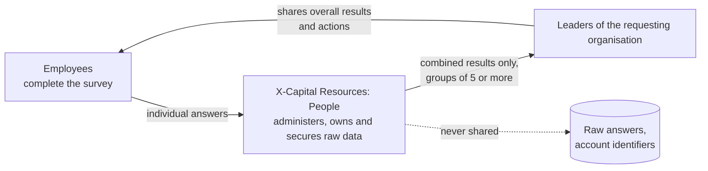
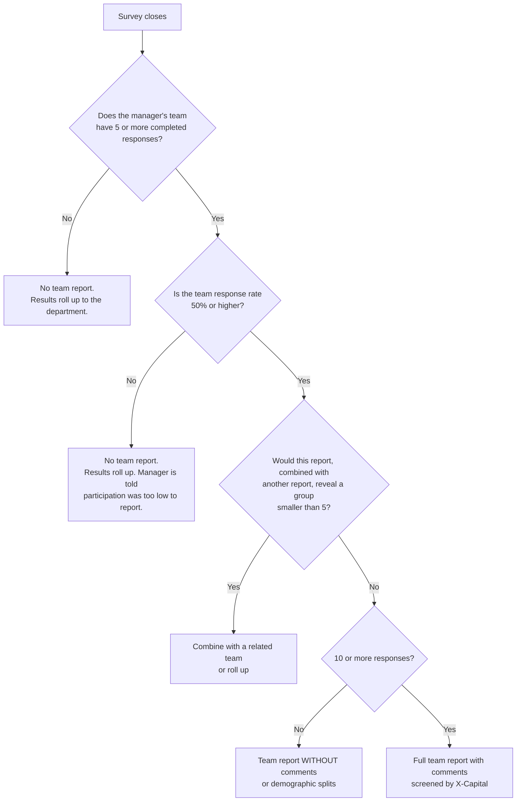

# Privacy and Anonymity

### Employee Engagement Survey, a product of X-Capital Resources: People

This document sets out how X-Capital Resources: People protects the people who take the survey. It covers who holds the data, what leaders receive, the **minimum group sizes for any report**, and how the survey complies with the Protection of Personal Information Act 4 of 2013 (POPIA).

> **Our promise to employees:** No one in your organisation will ever see your individual answers. Leaders receive combined results for groups of 5 or more people. X-Capital Resources: People will not help anyone identify who said what.

---

## 1. Who does what

| Party | Role | Sees |
|---|---|---|
| **X-Capital Resources: People** | Owns and administers the survey. Holds and secures the raw responses. Analyses data and prepares reports. Acts as the **responsible party** under POPIA for survey data it collects. | Raw responses (without names displayed), technical account identifiers needed to prevent duplicate submissions |
| **Requesting organisation** (the client) | Requests the survey, invites employees, receives reports, owns the action plan. | Combined results that meet the thresholds in section 3 only |
| **Managers** | Receive a team report if their team meets the minimum, and lead team action planning. | Their team's combined results only, if eligible |
| **Employees** | Take part voluntarily. | Their own answers while completing; the organisation-wide results shared afterwards |

The service agreement between X-Capital Resources: People and the client records these roles. Clients have no right to request raw data or individual responses, and X-Capital will refuse any such request.

---

## 2. Confidential, not identity-free

It is important to describe the survey accurately:

- **Confidential:** X-Capital Resources: People's systems need a technical account identifier to make sure each person responds only once. This identifier is held by X-Capital only, is never displayed with answers in reports, and is never given to the client.
- **Anonymous in reporting:** every report the client receives is aggregated and cannot be traced to an individual.

Employees are told this in the privacy notice at the start of the survey. Overstating anonymity damages trust if people later discover how the system works.

---

## 3. Minimum thresholds for reports

These rules apply to every report, chart, export and presentation produced for the client.

### 3.1 Reporting thresholds

| What is reported | Minimum required | If the minimum is not met |
|---|---|---|
| **Organisation-wide report** | **5 completed responses** | No report; X-Capital advises the client on improving participation |
| **Manager or team report** | **5 completed responses from that manager's team** (direct and indirect reports combined) **and** a team response rate of **at least 50%** | The team's results roll up into the next level (for example the department) and the manager receives the department report |
| **Department, site or business unit report** | 5 completed responses | Combined with other small groups or rolled up |
| **Demographic breakdown** (age, gender, service, level and so on) | 5 responses in each group shown | Small groups combined into "Smaller groups combined"; if that is still under 5, it is hidden |
| **Population group or disability breakdown** (special personal information) | **10 responses** in each group shown | Not reported for that group |
| **Cross-tabulations** (two characteristics combined, for example "female managers in Operations") | **10 responses** in each cell | Not produced |
| **Open comments** | **10 responses** in the unit reported | Comments are included only in the next level up |
| **Driver analysis** | 10 responses (30 recommended) | Not shown |
| **Trend comparison** | The thresholds above must be met in **both** survey rounds | Trend not shown |

The default minimum is **5**. X-Capital may agree to **3** only for very small organisations (under 15 employees) at the organisation-wide level, with the employees' agreement, and never for manager reports.

### 3.2 The minimum a manager needs to receive a report

**In short, a manager must have at least 5 people in their team who completed the survey, from a team where at least half responded, before they receive their own report.** Comments are only included when 10 or more team members responded. Managers never receive demographic breakdowns of their own team.

### 3.3 Protection against "working it out by subtraction"

Thresholds alone are not enough. If a department of 12 has a report, and one of its teams with 9 respondents also has a report, a reader could subtract one from the other and see the results of the remaining 3 people. X-Capital prevents this:

1. **No overlapping reports with a difference under 5.** Where two reports differ by fewer than 5 respondents, the smaller unit is combined or not reported.
2. **Hidden groups cannot be calculated from totals.** If only one small group is hidden in a breakdown, the next smallest group is combined with it, so the hidden group cannot be worked out from the organisation total.
3. **No ad hoc filters for clients.** Clients receive fixed reports. Additional cuts are requested from X-Capital, which checks them against these rules first.
4. **Report numbers are rounded** to whole percentages, and response counts for small groups are shown as ranges (for example "5 to 9") where needed.

### 3.4 Open comments

- Comments are read by X-Capital before release. Names, specific incidents, job titles that identify one person, and other identifying details are removed or the comment is withheld.
- Comments are shown in random order, not in the order submitted.
- Comments that disclose a risk of serious harm, abuse, harassment or a crime are handled under X-Capital's **duty-of-care protocol**: the information is escalated to an appropriate senior person at the client **without identifying the employee**, unless the law requires otherwise. Employees are told about this in the privacy notice.

---

## 4. POPIA compliance

POPIA sets eight conditions for lawful processing. This is how the survey meets each one.

| POPIA condition | How the survey complies |
|---|---|
| **1. Accountability** (s8) | X-Capital Resources: People has an appointed Information Officer and is accountable for the survey data. |
| **2. Processing limitation** (s9 to s12) | Only data needed for the survey is collected. Participation is voluntary and based on consent given at the start. All demographic questions are optional, with "Prefer not to say". |
| **3. Purpose specification** (s13 to s14) | Data is used only to measure and improve the employee experience at the client organisation and, in pooled anonymised form, to build benchmarks. Retention periods are set (section 6). |
| **4. Further processing limitation** (s15) | Data is not used for performance management, disciplinary action, selection or any purpose other than the one stated. |
| **5. Information quality** (s16) | Employees review their answers before submitting. |
| **6. Openness** (s17 to s18) | The privacy notice at the start of the survey explains who collects the data, why, who receives results, retention, and employees' rights. |
| **7. Security safeguards** (s19 to s22) | Access controls, encryption, need-to-know access within X-Capital, and a breach response plan (section 7). |
| **8. Data subject participation** (s23 to s25) | Employees may ask X-Capital to access, correct or delete their own response while the survey is open and before data is aggregated. |

### Special personal information

Race (population group), health and disability are **special personal information** under section 26 of POPIA. The survey collects them only:

- with the employee's **explicit consent** (section 27(1)(a)),
- as **optional** questions,
- for Employment Equity analysis and fairness monitoring, and
- with a stricter reporting threshold of 10 (section 3.1).

### Cross-border storage

If the survey platform stores data on servers outside South Africa, X-Capital ensures the transfer meets section 72 of POPIA (adequate protection in the receiving country, binding agreements, or consent). Clients are told where data is stored.

---

## 5. What leaders and managers must not do

Leaders and managers who receive results agree to these rules. Breaches may amount to victimisation under the Labour Relations Act and the Employment Equity Act.

| Do not | Instead |
|---|---|
| Try to work out who said something | Treat comments as themes affecting the group |
| Ask employees whether or how they responded | Thank everyone for taking part, as a group |
| Require proof of completion | Track only the overall response rate X-Capital provides |
| Discuss results that relate to identifiable individuals | Discuss patterns and solutions |
| Use results in performance reviews or disciplinary matters | Use results for team improvement only |
| Penalise a team for low scores | Support the manager to improve |
| Share team reports outside the leadership group without agreement | Share overall results with all staff, as agreed |

---

## 6. Data retention

| Data | Kept by | Retention |
|---|---|---|
| Raw individual responses | X-Capital only | **24 months** after the survey closes, to allow trend comparison with the next round. Then deleted or permanently de-identified. |
| Technical account identifiers | X-Capital only | Deleted once the survey closes and duplicates have been checked, or at the latest with the raw responses. |
| Aggregated reports | X-Capital and the client | As long as useful for trend analysis |
| Pooled benchmark data | X-Capital | Indefinitely, fully de-identified and combined across organisations; no client is identifiable |

---

## 7. Security and breach response

- Raw data is stored in access-controlled systems with encryption in transit and at rest.
- Only named X-Capital analysts working on the client's survey have access.
- Exports of raw data are stripped of identifiers, shuffled, and kept in secured locations.
- If a security compromise occurs, X-Capital notifies the **Information Regulator** and affected employees as soon as reasonably possible, as required by section 22 of POPIA, and informs the client.

---

## 8. How the survey app enforces these rules

| Rule | How the app applies it |
|---|---|
| Independent custody | Only the X-Capital account that owns the survey can read raw responses. Client leaders with Editor access see only the summary X-Capital chooses to share. Employees cannot see anyone's answers. |
| Minimum group size | Set in Settings (default 5). No results display below it. |
| Small groups | Groups under the minimum are combined. If the combined group is still too small, the next smallest group is added so the hidden group cannot be calculated by subtraction. |
| Comments | Shown only with 10 or more responses, in random order. X-Capital can exclude comments from the shared management report. |
| One response per person | Each person can submit once per survey round. |
| Data minimisation | Only the submission date is stored, not the time, to make identification by timing harder. |

---

## 9. Privacy notice shown to employees

> **Your privacy.** This survey is a product of X-Capital Resources: People. It is administered and owned by X-Capital Resources: People on behalf of **[organisation name]**, which requested it.
>
> Taking part is voluntary. Your answers are used only to understand and improve the employee experience at [organisation name], and in fully anonymised, combined form to build benchmarks.
>
> X-Capital Resources: People holds the raw responses. Leaders at [organisation name] receive combined results for groups of 5 or more people only. Your individual answers are never shared with your organisation and are never used for performance, disciplinary or selection decisions.
>
> Comments may be shared word for word without your name, after X-Capital removes identifying details. If a comment suggests someone is at risk of serious harm, X-Capital may raise the concern with the organisation without identifying you.
>
> The "About you" questions are optional. Population group and disability are special personal information under POPIA; by answering them you consent to their use for Employment Equity and fairness analysis only.
>
> Raw responses are kept for up to 24 months and then deleted or permanently de-identified. You may contact X-Capital Resources: People's Information Officer about your rights, and you may lodge a complaint with the Information Regulator.

---

## 10. Employee questions and answers

**Can my manager see my answers?** No. Managers only see combined results for teams with at least 5 respondents and a response rate of at least 50%.

**My team is very small. Will my answers be exposed?** No. If your team has fewer than 5 respondents, your answers are combined with a larger group before anyone sees them.

**Why do I need to sign in?** To make sure each person answers only once. Your sign-in is held by X-Capital Resources: People, not your employer, and is never shown with your answers.

**Will my comments be quoted?** They may be, without your name, after X-Capital removes anything that could identify you. Leave out names and specific incidents if you prefer.

**Do I have to answer the "About you" questions?** No. They are all optional.

**Can I be penalised for not taking part, or for what I said?** No. Taking part is voluntary, and victimisation is prohibited.

---

*© X-Capital Resources: People. Employee Engagement Survey companion document 03. This document summarises legal requirements for practical use and is not legal advice; X-Capital reviews it with legal counsel periodically.*
