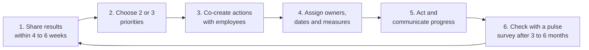

# Action Plan Templates

### Employee Engagement Survey, a product of X-Capital Resources: People

Survey results only matter if something changes. This document gives leaders and managers a simple process, blank templates, and ready-made action ideas for every section of the survey. The ideas are written for South African SMEs and mid-market businesses with limited HR capacity and budget.

---

## 1. The action planning cycle

**Golden rules**

1. **Fewer actions, done well.** Two or three priorities beat ten half-finished ones.
2. **Start with the priority matrix** in the report (see document 01). Fix what is low *and* strongly linked to engagement.
3. **Fix credibility first.** If D5, L5 and K8 are low, deliver one visible quick win before launching anything larger.
4. **Involve employees.** People support what they help create.
5. **Close the loop.** Tell people what you did because of their feedback, even when the answer is "not yet, and here is why".

---

## 2. Master action plan template

Copy this table for each priority.

| Field | Complete here |
|---|---|
| **Priority area** (section and items) | e.g. J: Remuneration (J3, J4) |
| **Current score** (favourable %) | |
| **Target score at next survey** | Typically +5 to +10 points |
| **What employees told us** (comment themes) | |
| **Root cause** (confirmed in team discussion) | |
| **Actions** | 1. 2. 3. |
| **Owner** (one named person per action) | |
| **Support needed** (budget, HR, X-Capital, SETA) | |
| **Start date / due date** | |
| **How we will communicate it** | |
| **Measure of success** | Survey item, pulse score or business measure |
| **Status** | Not started / In progress / Done |

### Action tracker

| # | Action | Section | Owner | Due | Status | Evidence of progress |
|---|---|---|---|---|---|---|
| 1 | | | | | | |
| 2 | | | | | | |
| 3 | | | | | | |

---

## 3. Team results session (90 minutes)

Use this agenda for every team that receives a report.

| Time | Activity |
|---|---|
| 10 min | **Welcome and ground rules.** Thank people for responding. Remind everyone that results are anonymous and no one will be asked how they answered. |
| 15 min | **Share the results.** Engagement Index, top 3 strengths, bottom 3 areas. |
| 15 min | **Celebrate strengths.** "What are we doing well that we must protect?" |
| 30 min | **Explore one or two priorities.** "What does this score mean to you? What gets in the way? What would make the biggest difference?" Use sticky notes or anonymous cards if trust is low. |
| 15 min | **Agree actions.** One or two team actions, each with an owner and a date. Note any issues that need leadership action. |
| 5 min | **Close.** Explain when and how progress will be shared. |

---

## 4. Section action plans

Each plan lists what low scores usually mean, then actions by time frame. Choose what fits. Costs: **R** low cost, **RR** moderate, **RRR** significant investment.

### A. Engagement Outcomes (Say, Stay, Strive)

*Engagement is an outcome. Improve it through the drivers below. Use this plan to address the overall pattern.*

| Time frame | Actions | Cost |
|---|---|---|
| 30 days | Share results openly with all staff, including the weaknesses. Leaders acknowledge what they heard. | R |
| 90 days | Run team sessions and agree priorities. Hold "stay interviews" with key people: "What keeps you here? What might make you leave?" | R |
| 6 to 12 months | Act on the top 2 or 3 drivers. Run a pulse survey including A1 to A6 and N1. | R to RR |
| **Measure** | Engagement Index, eNPS, voluntary turnover, absenteeism | |

### B. State of Mind and Wellbeing

*Low scores suggest excessive workload, chronic stress or burnout risk. If B2, B3 and B5 are all below 50%, treat as urgent.*

| Time frame | Actions | Cost |
|---|---|---|
| 30 days | Review workloads and overtime by team. Remove or postpone non-essential tasks. Remind staff of EAP and leave entitlements. | R |
| 90 days | Train managers to spot signs of stress and have supportive conversations. Agree "no after-hours messages" norms where possible. Fill critical vacancies. | R to RR |
| 6 to 12 months | Introduce or improve an EAP (many medical aids and insurers include one). Redesign roles or shifts with chronic overload. Build wellness into leadership KPIs. | RR |
| **Measure** | B2, B3, B5; overtime hours; sick leave; turnover | |

### C. My Immediate Manager or Supervisor

*Low scores usually reflect untrained supervisors, inconsistent treatment or lack of feedback. Managers have the biggest single influence on engagement.*

| Time frame | Actions | Cost |
|---|---|---|
| 30 days | Each manager holds a short one-on-one with every team member focusing on expectations (C1) and support needed. | R |
| 90 days | Introduce monthly one-on-ones with a simple agenda: wins, challenges, support, development. Train supervisors in feedback and fair treatment (often SETA-claimable). | R to RR |
| 6 to 12 months | Add people-leadership measures to manager performance reviews. Provide coaching or mentoring for supervisors who score low. | RR |
| **Measure** | C1 to C6; team turnover; grievance numbers | |

### D. Senior Leadership and Direction

*Low scores suggest employees do not understand the strategy, or do not trust that leaders will act on what they say.*

| Time frame | Actions | Cost |
|---|---|---|
| 30 days | Owner or MD presents survey results and one concrete commitment to all staff, in person where possible. | R |
| 90 days | Share a one-page strategy: where we are going, why, and what it means for each team. Leaders do regular walkabouts or site visits. | R |
| 6 to 12 months | Quarterly business updates for all staff. Track and publish progress on leadership commitments (supports D5). | R |
| **Measure** | D1 to D6, K8, L5 | |

### E. Work Environment, Tools and Safety

*Low scores point to inadequate equipment, broken processes, safety risks or infrastructure disruption.*

| Time frame | Actions | Cost |
|---|---|---|
| 30 days | Ask each team for its top 3 obstacles. Fix any safety hazard immediately (E2 is a legal duty under the OHSA). | R |
| 90 days | Agree a load-shedding and outage plan: backup power for critical functions, adjusted schedules, clear rules on pay and productivity during outages (E4). Review transport risks for early and late shifts (E5). | RR |
| 6 to 12 months | Invest in priority equipment and systems. Simplify the processes employees named as obstacles (E3). Audit working conditions against the BCEA (E6). | RR to RRR |
| **Measure** | E1 to E6; safety incidents; downtime | |

### F. Culture, Inclusion, Fairness and Belonging

*Low scores, or large gaps between groups, suggest some people feel excluded or treated unfairly.*

| Time frame | Actions | Cost |
|---|---|---|
| 30 days | Leaders restate a zero-tolerance stance on harassment and discrimination and explain how to report it safely (F5). | R |
| 90 days | Review the Employment Equity plan with the EE forum and share progress with staff (F3). Train managers on unconscious bias and inclusive meetings. Recognise cultural and religious diversity in scheduling and events. | R to RR |
| 6 to 12 months | Analyse pay, promotion and training by group (with privacy safeguards). Set measurable transformation goals beyond compliance. Build team rituals that reinforce ubuntu (F6). | RR |
| **Measure** | F1 to F6; gaps between groups; grievances | |

### G. Support in Challenging Times

*Low scores mean employees doubt the organisation will be there for them in a crisis, or do not know what support exists.*

| Time frame | Actions | Cost |
|---|---|---|
| 30 days | Publish a simple "Where to get help" sheet: EAP number, leave types, who to speak to, in the workforce's main languages (G2). | R |
| 90 days | Write a compassionate leave and flexibility guideline for family responsibility, illness and bereavement (G5). Offer financial wellness sessions on budgeting, debt and garnishee orders, through banks, retirement funds or NGOs (G3). | R |
| 6 to 12 months | Consider an emergency assistance or salary advance policy with clear rules. Commit to transparent, fair processes for any restructuring, in line with s189 of the LRA (G4, G6). | RR |
| **Measure** | G1 to G6; EAP usage | |

### H. Growth, Learning and Development

*Low scores suggest people see no future in the organisation, or training is unfair or unavailable.*

| Time frame | Actions | Cost |
|---|---|---|
| 30 days | Make sure the organisation is registered with its SETA and submitting a Workplace Skills Plan to access mandatory grant refunds. | R |
| 90 days | Each manager holds a career conversation with every team member (H4). Publish how promotions and internal vacancies work (H6). | R |
| 6 to 12 months | Apply for SETA discretionary grants for learnerships and skills programmes (H5). Create stretch assignments, job rotation or mentoring (H7). Map simple career paths for key roles (H3). Link to B-BBEE skills development points. | R to RR |
| **Measure** | H1 to H7; internal promotions; training spend per employee | |

### I. Recognition and Performance

*Low scores mean good work goes unnoticed, or performance management feels unfair.*

| Time frame | Actions | Cost |
|---|---|---|
| 30 days | Leaders and managers commit to specific, timely thanks every week. Start a "shout-out" moment in team meetings. | R |
| 90 days | Introduce a simple peer recognition scheme with clear, fair criteria (I4). Agree written goals with each employee (I3). | R |
| 6 to 12 months | Review the performance process for fairness and consistency. Address poor performance consistently and fairly, following the Code of Good Practice (I2). | R to RR |
| **Measure** | I1 to I4 | |

### J. Remuneration Standards and Policies

*Read the pattern: J1 low means below market; J2 or J5 low means perceived internal unfairness; J3 and J4 low means poor understanding of how pay works.*

| Time frame | Actions | Cost |
|---|---|---|
| 30 days | Check payroll accuracy and timing; fix errors immediately (J8). Explain payslip deductions in a short guide or session. | R |
| 90 days | Write or update a remuneration policy covering pay structure, increases, bonuses and benefits, and share it with all employees (J3, J4). Provide a total reward statement showing the value of benefits and employer contributions (J9). | R |
| 6 to 12 months | Benchmark pay for key roles against salary surveys or sector minimums (J1). Conduct an equal pay audit for work of equal value, as required under the Employment Equity Act (J2, J5). Agree an increase approach that considers CPI and affordability, and explain it (J6). Review benefits against employee needs (J7). | RR to RRR |
| **Measure** | J1 to J9; turnover of key roles; offer acceptance rate | |

> **Note:** Pay perceptions often improve when people understand how pay works, even before pay itself changes. Start with transparency (J3, J4, J9) while longer-term pay changes are planned.

### K. Communication and Employee Voice

*Low scores suggest information does not reach everyone, rumours fill the gap, or employees feel unheard.*

| Time frame | Actions | Cost |
|---|---|---|
| 30 days | Map who is not reached by current channels (no email, shift workers, remote sites). Start a WhatsApp broadcast list or notice board update for key news (K3). | R |
| 90 days | Hold a monthly all-staff briefing with a question-and-answer slot, in person or by voice note (K5). Translate key messages into the main workplace languages (K2). Commit that important news goes to staff before it spreads informally (K4). | R |
| 6 to 12 months | Create a suggestion system with a promise to respond within 2 weeks (K6). Set up a confidential whistleblowing line or independent channel (K7). Report back on survey actions every quarter (K8). | R to RR |
| **Measure** | K1 to K8; number of suggestions implemented | |

### L. Change Management

*Low scores suggest change is imposed without explanation, involvement or support, or that there is too much change at once.*

| Time frame | Actions | Cost |
|---|---|---|
| 30 days | List all current changes and initiatives. Pause or sequence what is not essential (L7). | R |
| 90 days | For every significant change, use a simple change plan (template below). Brief managers first so they can explain it to their teams (L6). Consult employees, and unions where relevant, before decisions are final (L2). | R |
| 6 to 12 months | Train managers in leading change (for example ADKAR). Provide practical training before new systems go live (L3). Review each change after 90 days and report what was learned (L4, L5). | R to RR |
| **Measure** | L1 to L8; adoption of new systems or processes | |

**One-page change plan (ADKAR-based)**

| Question | Answer |
|---|---|
| What is changing, and when? | |
| **Why** is it changing? (Awareness, L1) | |
| Who is affected, and how? | |
| How will we consult and involve them? (Desire, L2) | |
| What training or support do people need? (Knowledge and Ability, L3) | |
| Who communicates, through which channels, and how often? (L6) | |
| What could go wrong, and how will we respond? | |
| How will we know it worked, and how will we reinforce it? (Reinforcement, L5) | |

### M. Role Clarity, Purpose and Teamwork

*Low scores indicate unclear roles, weak cooperation between teams or limited autonomy.*

| Time frame | Actions | Cost |
|---|---|---|
| 30 days | Each manager confirms the top 3 priorities and responsibilities for every role (M1). | R |
| 90 days | Update job descriptions with employees' input. Share customer feedback and stories that show the impact of people's work (M2). Hold joint sessions between teams that depend on each other (M4). | R |
| 6 to 12 months | Agree decision rights so people know what they can decide alone (M5). Celebrate cross-team successes. | R |
| **Measure** | M1 to M5 | |

### N. eNPS and O. Comments

| Situation | Action |
|---|---|
| eNPS below 0 | Treat with the same urgency as a Low Engagement Index. Hold listening sessions to understand detractors' concerns. |
| Many comments on one theme | Add it as a priority even if its score is moderate; comments often signal emerging issues. |
| Practical suggestions in comments | Implement easy ones quickly and credit "employee suggestions" publicly. |

---

## 5. Communicating back: "You said, we did"

Use this format on notice boards, WhatsApp, team meetings and email, every quarter.

| You said | We did | Still to come |
|---|---|---|
| *e.g. "We don't understand how increases are decided."* | *Published our remuneration policy and held briefing sessions at every site.* | *Pay benchmarking for key roles by March.* |
| | | |
| | | |

**Sample message**

> Thank you to the [X]% of you who took part in our engagement survey run by X-Capital Resources: People. You told us that [priority 1] and [priority 2] matter most. Here is what we have done so far: [actions]. Next, we will [actions] by [date]. We will update you again in [month].

---

## 6. 90-day review checklist

- [ ] Has every action got a named owner and a due date?
- [ ] Have we told employees what we are doing?
- [ ] Are at least one or two quick wins visible to staff?
- [ ] Have managers held their team sessions?
- [ ] Are any actions stuck, and what is needed to unblock them?
- [ ] Should we run a short pulse survey on the priority items?

---

## 7. Support from X-Capital Resources: People

X-Capital Resources: People can facilitate results presentations and team sessions, coach managers, help develop remuneration and change management policies, prepare SETA and skills development submissions, and run follow-up pulse surveys.

---

*© X-Capital Resources: People. Employee Engagement Survey companion document 04.*
